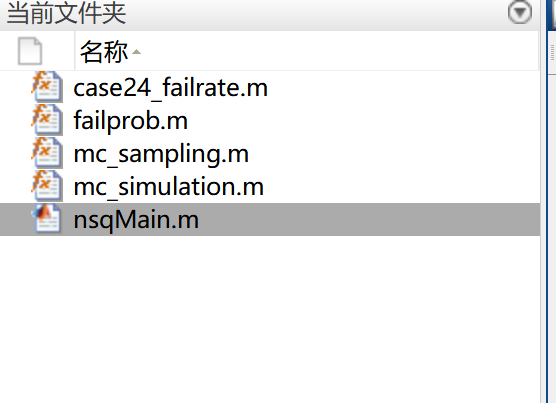
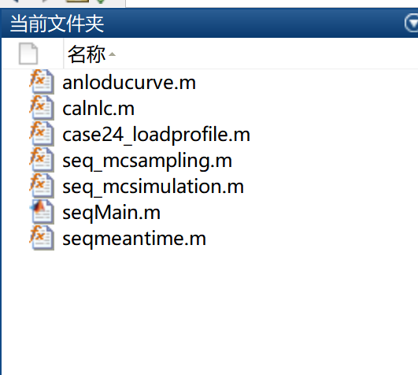

# Reliable Assessment of Power Systems Based on Monte Carlo Simulation (Matlab Code Implementation)

Monte Carlo-based Reliability Assessment of Power Systems (Matlab Code Implementation)

## Images

<!-- PAYMENT_BLOCK -->

## Get this dataset

- Payment link (Stripe): [Buy now](https://buy.stripe.com/3cs8yP7sY87d0vu9AB)
- Payment QR code: 

<!-- /PAYMENT_BLOCK -->
